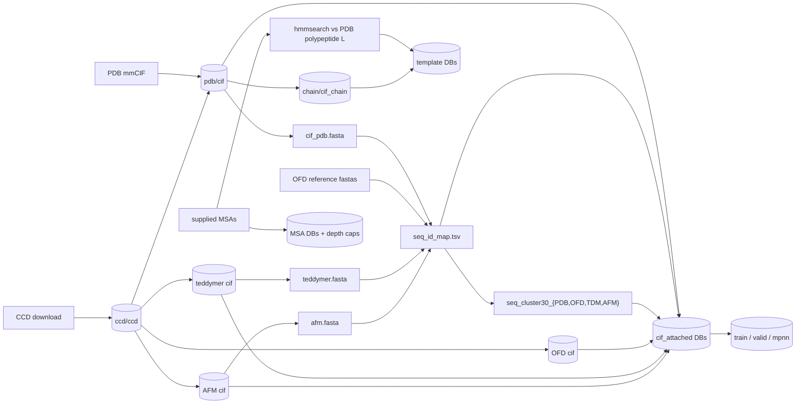

# Stages — what each DB is built from

Every output of the release is one stage, one `db/<group>/<name>.yaml`, and the release is
the DAG of all 94 of them in `db/MANIFEST_all.yaml`. This page goes through it data set by
data set: what the stages do, which recipe and reader they use, and the parameters that
decide the result (quoted from the configs). How to run the whole DAG is the
[end-to-end build](e2e-build.md); where the inputs live is [raw materials](raw-materials.md).
In the paths below, `$R` is `BIOMOL_ROOT`.

## How a config runs

A config names a `recipe` (a module under `src/structcooker/workflows/`), its `reader` /
`writer` hooks (under `src/structcooker/instructions/`), a source and a target. The op is
inferred from which keys it sets (`workflow_ops.op_of`):

| Op | Config sets | Runs as | Output |
|---|---|---|---|
| `build` | `env_path` (+ `data_dir`/`file_pattern` or `file_list`) | DataCooker pipeline: plan → shard array → merge → index | LMDB |
| `rebuild` | `old_env_path` → `new_env_path` | same pipeline, sized from the source's `.index.tsv` | LMDB |
| `extract` | `db_path` + `extract_recipe_path` + `output_data_path` | one workflow job (200 GB, 32 cores) | FASTA / TSV |
| `materialize` | `recipe_path` + `output_data_path` | one workflow job (128 GB, 8 cores; a full node if `inputs.n_jobs` asks for it) | FASTA / TSV / work list |
| `parallel` | `split_recipe_path` + `recipe_path` | one full-node job, or an N-task array with `node_count: N` | files |

LMDB stages carry a `schema:` tag (value type, see `src/structcooker/schemas.py`); it is
stripped before the config reaches DataCooker. Schemas in use: **A** `{assembly_dict,
metadata_dict}` (base structures), **B** attached CIFMol, **C** per-chain BioMol, **D**
template mols, **E** `{msa_dict}`, **G** CCD `{chem_comp_dict}`, **H** pruned CIFMol (MPNN),
**I** valid-1 filtered CIFMol.

```bash
structcooker list                          # every db config: op, schema, target
structcooker build <group>/<name> --show   # resolved invocation, no submit
structcooker build <group>/<name>          # one stage on its own (no release bookkeeping)
```

Keys are set by a `key_builder` where file names do not carry them (OpenFold entries are all
named `alignment.npz`, ...). Reader maps a stage depends on (`MONOMER_SEQID_MAP`,
`AFM_CIF_OVERRIDES`, ...) are declared under `runtime_environment`, so they are part of the
stage's fingerprint.

## Data flow



Per set: structures → FASTA → shared `seq_id` → per-DB clusters → attached DB; MSAs are
ingested from supplied or downloaded alignments and capped; templates come from an
hmmsearch over the PDB polypeptide(L) chains (PDB, teddymer, AFM) or from the OpenFold
`template.npz` hits, always read from `chain/cif_chain`.

## CCD

`ccd/ccd` (build, schema G) → `$R/lmdb/ccd/biomol_CCD.lmdb`, keyed by component id.

- Input: `structcooker download ccd` keeps the wwPDB download in
  `materials/raw/ccd/components_<date>.cif.gz` (this release: `components_20260803`) and
  splits it into one `<COMP_ID>.cif` per `data_` block under
  `materials/intermediate/ccd/components/` (50,782), the stage's `data_dir`.
- Reader `readers.cif.get_cif_data` loads `_chem_comp`, `_chem_comp_atom`,
  `_chem_comp_bond`; recipe `ingest/ccd.py` groups the rows and parses them into
  `chem_comp_dict`; writer `transforms.codecs.to_bytes`.
- No upstream; every structure stage depends on it. FoldBench's inference CCD
  (`lmdb/ccd/ccd_inference.lmdb`) is a reshape of it, see [FoldBench](foldbench.md).

## PDB structures

| Stage | Op / schema | Does |
|---|---|---|
| `pdb/cif` | build, A | `materials/raw/cif/*.cif.gz` → `lmdb/pdb/cif/cif_pdb.lmdb`, keyed by PDB id |
| `pdb/cif_attached` | rebuild, B | adds `seq_id` / `cPDB_` cluster per chain; one record per bioassembly |
| `chain/cif_chain` | rebuild, C | one record per chain, `<pdbid>_<chain>`; the template coordinate source |

- `pdb/cif`: recipe `ingest/cif.py`, reader `get_cif_data` + `key_transform: dot_transform`.
  Components are resolved against `ccd_db_path` (the CCD above) and `ccd_reference_path`
  (`materials/reference/reference_ccd.lmdb`, 24 historical definitions for atoms removed
  from the current CCD; a missing definition fails instead of dropping atoms).
  `test_run: false`: a truncated or empty mirror file is counted as failed instead of
  aborting a shard; the five PDB entries the parser cannot map are listed in
  `db/release-exceptions.json`.
- Attach (`workflows/metadata/attach.py`, metadata recipe `load_sequence_metadata.py`,
  adapter `transforms.cifmol.convert_to_cifmol_dict`, `split_entries: true`) is the same for
  every set; `metadata_input` names the set's FASTA, `seq_id_map.tsv`, its
  `seq_cluster30_<DB>.tsv` and `db_code`.
- `chain/cif_chain`: recipe `exports/cif_chain.py`, adapter
  `transforms.template.adapt_cif_record_to_chain_inputs`, `explode_entries: true`
  (`explode_value_key: biomoldict`). Each chain comes from the best-occupancy model;
  `parameters.reference_selection_path` (`reference_chain_selection.lmdb`) reproduces the
  release's choice on ties, numeric model order without it.

Extracts from `cif_pdb.lmdb`: `metadata/cif_fasta` (`exports/fasta.py` →
`materials/intermediate/fasta/cif_pdb.fasta`) and `metadata/cif_metadata`
(`metadata/extract.py` → `$R/metadata/cif_metadata.tsv`: resolution, dates, chain/residue/atom
counts, NA/D-form flags, read by the template date rule).

## Sequence ids and clustering

The rules are in [seq_id and cluster scheme](seq-id-and-cluster-scheme.md): one `seq_id`
space for every DB, one clustering per DB.

- `metadata/seq_id_map` (materialize, `metadata/seq_id_map.py` → `$R/metadata/seq_id_map.tsv`).
  `fasta_paths`, in this order: `cif_pdb.fasta`, the four OFD reference fastas
  (short, long, rna, disordered), `teddymer.fasta`, `afm.fasta`, `ofd_long_recovered.fasta`.
  A seq_id is a running counter per molecule type, not a hash, so order matters: a set
  appended last moves no earlier id. `old_seq_id_map_path`
  (`materials/reference/seq_id_map_seed.tsv`) seeds it — present, the ids match the
  release; absent, a fresh self-consistent space.
- Per-DB FASTAs: `metadata/ofd_fasta` (concat of the four reference fastas → `ofd.fasta`),
  `metadata/teddymer_fasta`, `metadata/afm_{homodimer,heterodimer}_fasta` + `metadata/afm_fasta`
  (concat), `metadata/ofd_{short,long}_fasta` (from the PDB-built OFD cif, chain `A`, for the
  attach keys), `metadata/ofd_long_recovered_fasta` (`metadata/new_sequences.py`: the 14 long
  entries recovered 2026-09-14 that no reference fasta has).
- Per-DB views of the map: `metadata/teddymer_seq_id_map`, `metadata/afm_seq_id_map`
  (`subset_seq_id_map.py`; fail if a sequence has no id), `metadata/distillation_monomer_seqid`
  (entry → seq_id for the OFD short/long/rna MSA keys), `metadata/afm_msa_seqid`.
- Clustering: `metadata/{pdb,ofd,teddymer,afm}_seq_cluster30` (`search/seq_cluster.py`,
  writer `projections.write_clusters`) → `$R/metadata/seq_cluster30_{PDB,OFD,TDM,AFM}.tsv`,
  ids `c<DB>_<rep seq_id>`. All four: `mmseqs2_seq_id: 0.30`, `mmseqs2_cov: 0.8`,
  `mmseqs2_covmode: "0"`, `mmseqs2_clustermode: "1"`, with the SAbDab summary
  (`materials/raw/sabdab/sabdab_summary_all.tsv`) for antibody handling.

## MSAs

The PDB alignments are a supplied input (`materials/reference/msa`, HHblits, searched once);
the release does not search again.

| Stage | Source | Depth |
|---|---|---|
| `msa/a3m` | `reference/msa/P/*/P*/P*.a3m` | as supplied |
| `msa/a3m_d16k`, `a3m_d2k`, `a3m_d512` | `a3m.lmdb` | `max_depth` 16000 / 2000 / 512 |
| `msa/msa_rna` (`inputs.a3m_type: rna`) | `reference/msa/R/*/R*/R*.a3m` | as supplied |
| `msa/msa_rna_d2k`, `msa_rna_d512` | `msa_rna.lmdb` | 2000 / 512 |

- Build: recipe `ingest/a3m.py`, loader `readers.a3m.get_a3m_data` (sequences + headers →
  `msa_dict`), key = file stem = seq_id. Outputs under `$R/lmdb/pdb/msa/`.
- Depth caps (every set): rebuild through `exports/cap_msa_depth.py`, adapter
  `transforms.openfold.adapt_msa_for_cap`; only `parameters.max_depth` differs. A cap keeps
  the query and the first hits and recomputes the profile and deletion mean; it is not a
  random subsample, and it keeps at least the query row.
- Coverage (2026-09): 178,249 protein and 6,572 RNA alignments. Of the PDB's distinct
  L-protein sequences, 351 with known residues have no supplied MSA (plus 13 all-X); the 12
  RNA sequences without one are all-N. The RNA alignments are the sanitized ones
  ([RNA MSA exceptions](history/rna_msa_sanitized_exceptions.md)).
- Parser rules worth knowing: header parsing resets per row (an unknown hit does not inherit
  the previous hit's species); insertion counts follow aligned columns, trailing lowercase
  insertions are dropped; an invalid row width fails with its row number.

## PDB templates

hmmbuild turns each query a3m into an HMM, hmmsearch runs it against the PDB polypeptide(L)
chains, and the hits are built into template mols read from `chain/cif_chain`.

| Phase | Stage | Op | Output |
|---|---|---|---|
| target | `metadata/pdb_polypeptide_L` | materialize | `fasta/pdb_polypeptide_L.fasta` |
| work list | `metadata/template_chain_filelist` | materialize | `worklists/template_chain_filelist.txt` |
| query prep | `template/msa_wo_lower` | parallel | `intermediate/msa_wo_lower/` (`filters/a3m_cleanup.py`: lowercase insertion columns dropped, since hmmbuild needs fixed width) |
| 0 | `template/hmmsearch` | parallel, `node_count: 8` | `intermediate/hmm/`, `hmm_output/` (`search/hmmsearch.py`; an existing HMM / `.out` is skipped) |
| 1/2 | `template/template_candidates` | materialize, `n_jobs: 112` | `seqid_to_chains.tsv`, `chain_to_templates.tsv`, `hmm_reduced/` |
| 3 maps | `template/template_seqs`, `metadata/seqid_template_filelist` | materialize | `seqid_to_seq.tsv`, `chain_to_seq.tsv`, `seqid_template_filelist.txt` |
| 3 | `template/seqid_template_mols` | build (keyed), D | `lmdb/chain/template/seqid_template_mols.lmdb` |
| 4 | `template/chain_template` | build (keyed), D | `lmdb/chain/template/template.lmdb`, keyed `<pdbid>_<chain>` |

- Phase 1/2 keeps up to `topk: 20` templates per chain released on or before
  `date_cutoff: "2021-09-30"` and at least `day_diff: 60` days before the query's own
  release (the AF3 rule); dates from `cif_metadata.tsv`.
- Phase 3 runs kalign and builds the union of template mols once per seq_id (about 5.7×
  fewer than per chain); Phase 4 copies each chain's templates out of it (no kalign, no CIF
  decode), via `metadata/load_phase4_maps.py`.

## Train, valid and MPNN

The filters trim each assembly by token count, polymer chain count, resolution and date
window, remove water, and drop SignalP-flagged regions (`metadata/load_signalp.py`, reading
`materials/reference/signalp`).

| Stage | Source | Recipe | Parameters |
|---|---|---|---|
| `train/train_20210930` (B) | `cif_pdb_attached` | `filters/data_attached.py` | `resolution_cutoff: 9.0`, `min_token_count: 1`, `max_polymer_chain_count: 300`, `end_date: 2021-09-30` |
| `train/train_20260301` (B) | `cif_pdb_attached` | same | same, `end_date: 2026-03-01` |
| `valid/valid1` (I) | `cif_pdb` | `filters/data.py` | `resolution_cutoff: 4.5`, `max_token_count: 2560`, `max_polymer_chain_count: 20`, 2021-09-30 → 2023-09-30 |
| `valid/valid1_attach` (B) | `cif_valid_1` | `metadata/attach.py` | `db_code: PDB` |
| `valid/valid2` (B) | `cif_attached_valid_1` | `filters/validation_stage2.py` | drops entries whose clusters overlap train / valid-1 sequences or interacting clusters |
| `train/train_20210930_mpnn` (H) | `train_20210930` | `filters/mpnn.py` | see below |

Valid-2 inputs are extracted from our own DBs so headers match `cif_pdb.fasta`:
`metadata/train_fasta` (`exports/fasta_attached.py`), `metadata/valid_1_fasta`
(`exports/fasta_transformed.py`), `metadata/interacting_seq_ids` (contact pairs of
`cif_pdb_attached`) and `metadata/interacting_seq_clusters` (those mapped to `cPDB_` clusters).

**MPNN** is a model-input view: it keeps only what the MPNN and its cropper read
(`atom_features: [xyz, id]`, `residue_features: [cif_idx, one_letter_code_can]`,
`chain_features: [entity_type, chain_id, seq_id, cluster_id]`, `chain_edge_features: [contact]`,
`compact_index_table: true`) and explodes each `{assembly}_{model}_{altloc}` into its own key
(`explode_entries`, `explode_value_key: mpnn_dict`), so one key is one training sample.
Measured on the source (167,912 keys, 47.9 GiB): field pruning alone stops at ~48% of the
compressed size, because what it drops (CCD strings, bond graphs) is what zstd compresses
best; the explode costs disk (~21.6 G nested → ~30 G exploded) in exchange for reads of
~80 KB instead of ~250 KB. Coordinates stay all-atom float64 — backbone-only and float32 are
modelling decisions, not storage ones. The stored index table has only `atom_to_res` and
`res_to_chain`, so read records through the loader:

```python
from structcooker.instructions.transforms.codecs import from_bytes
from structcooker.instructions.transforms.pruning import load_pruned_cifmol

mol = load_pruned_cifmol(from_bytes(raw_value))     # -> CIFMolAttached
```

## OpenFold distillation (OFD)

Four sets under `materials/raw/openfold_distillation`: short and long monomers, RNA
monomers, and the PDB-derived disordered set. `<set>` below is `short`, `long`, `rna` or
`disordered`; targets are under `$R/lmdb/distillation_<set>/`.

| Output | Stage | Op / schema | Recipe and source |
|---|---|---|---|
| structure | `<set>_cif` | build, A | short, long: `ingest/teddymer_structure.py` on `raw/<id>/best_structure_relaxed.pdb[.zst]`; rna, disordered: `ingest/openfold_structure.py` on `structure.npz` |
| attached | `<set>_cif_attached` | rebuild, B | `metadata/attach.py`, `db_code: OFD` |
| contacts | `disordered_contacts` | rebuild, B | `ingest/disordered_contacts.py`: recomputes the 6 Å chain-chain contact graph (the npz layout has none); its output is the final disordered attached DB |
| MSA | `<set>_msa` | build, E | `ingest/openfold_msa.py` on `alignment.npz`, `max_depth: 65536` |
| MSA caps | `<set>_msa_d2k`, `_d512`; `short_msa_d5k`, `rna_msa_d5k` | rebuild, E | `cap_msa_depth`, 2000 / 512 / 5000 |
| templates | `short_template_topn`, `long_template_topn` | build, D | `ingest/openfold_template_topn.py` on `template.npz`, `min_coverage: 0.1`, `max_keep: 20` |
| templates | `disordered_template` | build, D | `ingest/openfold_template_disordered.py`: 4 backbone atoms per protein chain |

RNA has no templates (the set ships none).

- **Structures.** Short and long are read from the released model
  (`readers.openfold.get_openfold_pdb_structure_data`, `file_pattern:
  "best_structure_relaxed.pdb|best_structure_relaxed.pdb.zst"` — exact names, so s5cmd
  partials are not picked up): pLDDT from the B column into `b_factor`, the C-terminal OXT
  kept, chain `A`, bonds from the CCD. RNA and disordered are read from `structure.npz`
  (`get_openfold_structure_data`) and carry `b_factor` 0, as OpenFold publishes no pLDDT for
  them. Either way the transform rebuilds the hierarchy into a `CIFMol` and derives the
  chemistry the source lacks (aromatic, stereo, charge, `model_xyz`, bond types) from the CCD,
  so the records share the PDB schema.
- **Keys.** Structures and monomer templates: `openfold_entry_key` (the entry folder).
  Monomer MSAs: `openfold_seqid_key` via `MONOMER_SEQID_MAP`
  (`worklists/distillation_monomer_seqid.tsv`), so they share the PDB MSA key space and hold
  one record per unique sequence (`duplicate_input_policy: first_path`). Disordered MSAs:
  `openfold_disordered_seqid_key` via `DISORDERED_SEQID_MAP`; disordered templates:
  `openfold_chain_key`. The disordered MSA and template stages read the work lists in
  `materials/reference/openfold_distillation/disordered_set/` (`msa_filelist.txt`,
  `protein_tmpl_filelist.txt`), whose lines are relative to `data_dir`.
- **MSA payloads.** The reader returns every source in the npz (protein: one; RNA:
  `rnacentral_hits` / `nt_hits` / `rfam_hits`) keyed by source name; `inputs.a3m_type` is
  `protein` or `rna`. 840 `alignment.npz` files are empty or corrupt in the release (long
  667, short 173) and are listed in `db/release-exceptions.json`.
- **Templates.** `openfold_template_topn` ranks each entry's hits by query coverage (from
  `idx_map` alone), decodes them best-first from `chain/cif_chain` and stops at `max_keep`.
  The long set reads 14 recovered `structure.npz` through `OPENFOLD_STRUCTURE_OVERRIDES`
  (`intermediate/openfold_distillation/long_recovered/overrides.json`, made by
  `scripts/staging/recover_ofd_long_npz.py`).

## Teddymer (TDM)

510,454 TED domain pairs, each two domains of one AFDB v4 model as chains A/B (a
domain-domain interface, not two proteins), staged by `scripts/staging/stage_teddymer.py`.

| Stage | Op / schema | Notes |
|---|---|---|
| `teddymer/cif` | build, A | `ingest/teddymer_structure.py`, loader `readers.teddymer.get_teddymer_structure_data`, key `teddymer_entry_key`; bonds derived from the CCD |
| `metadata/teddymer_fasta` → `teddymer_seq_cluster30` → `teddymer/cif_attached` | extract / materialize / rebuild B | `db_code: TDM` |
| `teddymer/msa`, `msa_d2k` | build E / rebuild E | `reference/msa_teddymer/P/*/P*/P*.a3m`; cap 2000 |
| `teddymer/msa_wo_lower` → `teddymer/hmmsearch` | parallel | `_TDM` trees; `load_pending_a3m_list.py` lists only queries without a `.out`, `node_count: 8` |
| `teddymer/template_candidates` | materialize | `ingest/template_candidates_seqid.py`: per seq_id, `date_cutoff: "2021-09-30"`, `max_candidates: 60`, `n_jobs: 112` |
| `teddymer/template` | build (keyed), D | `ingest/seqid_template_mols_topk.py`: kalign in e-value order, keep candidates covering 10–95% of the query, `max_keep: 20`, `allow_missing_chains: true` |

The MSAs are a supplied input: MMseqs2 against UniRef30 2302 alone, searched once (median
depth lower than HHblits — measured 6,456 vs 11,028 on 200 sequences). The pattern is
anchored on the seq_id stem so leftover HHblits files are not mixed in. Templates are keyed
by seq_id, not chain: a predicted domain has no release date, so the only date rule is the
global cutoff, and no per-chain Phase 4 follows.

## AFDB multimer (AFM)

1,750,755 high-confidence homodimers (the manuscript set, PDB files) and 80,248
heterodimers (`passes_quality_threshold`, mmCIF), staged by
`scripts/staging/stage_afdb_multimer.py` / `stage_afdb_multimer_msa.py`. Keys are the entity
(`AF-<n>`, `readers.afdb.afdb_entity_key`).

| Stage | Op / schema | Notes |
|---|---|---|
| `afdb_multimer/homodimer_cif` | build, A | the teddymer PDB reader and recipe, unchanged |
| `afdb_multimer/heterodimer_cif` | build, A | the PDB path (`ingest/cif.py`, `readers.afdb.get_afm_cif_data`); 6 repaired files substituted through `AFM_CIF_OVERRIDES` |
| `metadata/afm_*_fasta`, `afm_seq_cluster30`, `afm_seq_id_map` | extract / materialize | one `afm.fasta`; `cAFM_` clusters |
| `afdb_multimer/{homo,hetero}dimer_cif_attached` | rebuild, B | `db_code: AFM` |
| `metadata/afm_msa_filelist`, `afm_msa_seqid` | materialize | release MSAs in `raw/afdb_multimer/msa/` + the one generated MSA; entity → seq_id (heterodimer chains via `chain_msa.tsv`) |
| `afdb_multimer/msa`, `msa_d2k` | build E / rebuild E | `key_builder: afm_msa_seqid_key`; `map_size` 1.5 TB / 600 GB |
| `afdb_multimer/msa_wo_lower` → `hmmsearch` → `template_candidates` → `template` | parallel / materialize / build D | as teddymer, `_AFM` trees; `msa_wo_lower` also decompresses, drops the `#` line and renames to seq_id |

The MSAs are the release's own (ColabFold / MMseqs2-GPU against UniRef30 2302 with a taxon
filter), not the HHblits lineage of PDB / OFD. Entities sharing a sequence collapse to one
record, keeping the first.

## Outside the release DAG

`db/teddymer/msa_search.yaml` (parallel, `search/msa_search_mmseqs.py`) is the MMseqs2 search
that produced the teddymer MSAs. Run it by hand, only for sequences that have none (for
example after adding teddymer entries); it reads the search databases under `SEQ_DB_ROOT`
(`uniref30/2302/msadb/uniref30_2302`, `tools/mmseqs/bin/mmseqs`) and writes
`<seq_id>.a3m` into `materials/reference/msa_teddymer/`. Parameters: `threads: 28`,
`chunk_size: 1000`, `n_jobs: 4` (4 × 28 = 112 CPUs), `node_count: 8`.

```bash
structcooker build teddymer/msa_search
```

## Interface units (outside the release DAG)

`lmdb/interface/pdb/interface_pdb.lmdb` is not a `db/` config: it is built by `structcooker interface build`
from `lmdb/pdb/cif/cif_pdb.lmdb` (waters included, which `cif_pdb_attached` drops) with its own multiprocessing
driver, because one input record fans out into many self-contained unit records. Rules, schema, split and
reproduction: [Interface DB](interface-db.md).
