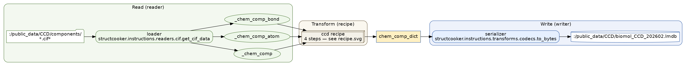
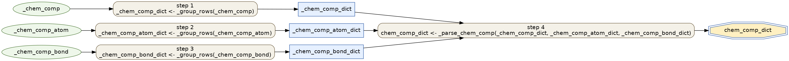
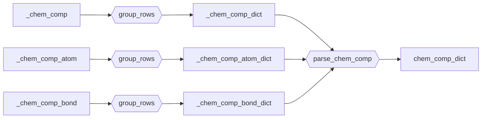

# CCD ingest

Ingest the wwPDB **Chemical Component Dictionary** (CCD) into an LMDB keyed by
component id. This is step 1 of the [data flow](../data-flow.md) — the CIF
ingest resolves residues/ligands against it.

- Recipe (Transform): `structcooker.workflows.ingest.ccd` (`chem_comp_dict`)
- Config (Read/Write boundary, source, target):
  [`db/ccd/ccd.yaml`](https://github.com/SanggeunParrk/StructCooker/blob/main/db/ccd/ccd.yaml)
  — schema `G` (`{chem_comp_dict}`, keyed by comp id), op `build`

The recipe is the *Transform* layer only. The *Read* (loader) and *Write*
(serializer) boundaries come from the config, not the recipe — see the
[DataCooker LMDB guide](https://CSSB-SNU.github.io/DataCooker/tutorials/build_lmdb/)
for how those hooks work.

## Input

`structcooker download ccd` keeps the wwPDB download as raw
(`DATA_ROOT/BioMol/materials/raw/ccd/components_<date>.cif.gz`) and splits it
into one `<COMP_ID>.cif` per `data_` block under
`DATA_ROOT/BioMol/materials/intermediate/ccd/components/` — that split directory
is the build's `data_dir`. See [raw materials](../raw-materials.md).

## Pipeline (Read → Transform → Write)

The split CCD `*.cif` files are loaded by `get_cif_data` into the three raw
tables the recipe consumes; the recipe produces `chem_comp_dict`; `to_bytes`
serializes it into the CCD LMDB.



| Boundary | Hook | Value |
|----------|------|-------|
| Read  | `loader`     | `structcooker.instructions.readers.cif.get_cif_data` |
| Write | `serializer` | `structcooker.instructions.transforms.codecs.to_bytes` |
| Source | files   | `DATA_ROOT/BioMol/materials/intermediate/ccd/components/*.cif*` |
| Dest   | LMDB    | `OUTPUT_ROOT/ccd/biomol_CCD.lmdb` |

## Transform recipe



```text
Targets: chem_comp_dict
Execution order:
1. _chem_comp_dict      <- _group_rows(_chem_comp)
2. _chem_comp_atom_dict <- _group_rows(_chem_comp_atom)
3. _chem_comp_bond_dict <- _group_rows(_chem_comp_bond)
4. chem_comp_dict       <- _parse_chem_comp(_chem_comp_dict, _chem_comp_atom_dict, _chem_comp_bond_dict)
```



## Run

```bash
pixi run structcooker build ccd/ccd --show   # resolved pipeline invocation
pixi run structcooker build ccd/ccd          # size, submit, merge, index
```

`ccd/ccd` has no upstream in `db/MANIFEST_all.yaml`; every structure build
(`pdb/cif`, `distillation/*_cif`, `teddymer/cif`, `afdb_multimer/*_cif`)
depends on it, so `build-all` builds it first.
