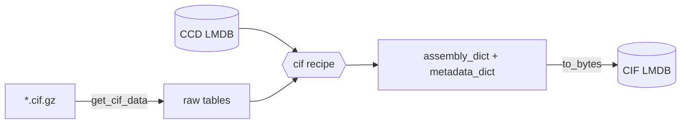

# CIF ingest

Ingest RCSB **mmCIF** structures into the core CIF LMDB. Each record is the
assembly graph (`assembly_dict`) plus `metadata_dict`, loadable as a
[`CIFMol`](../index.md). Components are resolved against the
[CCD LMDB](ingest-ccd.md).

- Recipe: `structcooker.workflows.ingest.cif` (`assembly_dict`, `metadata_dict`)
- Config:
  [`db/pdb/cif.yaml`](https://github.com/SanggeunParrk/StructCooker/blob/main/db/pdb/cif.yaml)
  — schema `A`, op `build`, target `OUTPUT_ROOT/lmdb/pdb/cif/cif_pdb.lmdb`

| Boundary | Hook | Value |
|----------|------|-------|
| Read | `loader` | `structcooker.instructions.readers.cif.get_cif_data` |
| Read | `key_transform` | `structcooker.instructions.readers.cif.dot_transform` |
| Write | `serializer` | `structcooker.instructions.transforms.codecs.to_bytes` |
| Source | files | `*.cif.gz` under `MMCIF_ROOT` (default `DATA_ROOT/BioMol/materials/raw/cif`) |
| Extra input | `ccd_db_path` | `OUTPUT_ROOT/ccd/biomol_CCD.lmdb` from the [previous step](ingest-ccd.md) |
| Extra input | `ccd_reference_path` | `OUTPUT_ROOT/metadata/reference_ccd.lmdb` — historical definitions for atoms removed from the current CCD |

The key is the PDB id (`dot_transform` handles the `.cif` suffix). The recipe
extracts metadata (`_entry.id`, resolution, deposition date), merges chemical
components, builds assemblies, and computes chain/length stats. The config sets
`test_run: false`: a truncated or empty file in the mirror is skipped and
counted as failed instead of aborting a shard.



## Run

Before the first build, 53 mmCIFs need a manual substitution — see
[manual CIF fixes](../manual-cif-fixes.md).

```bash
pixi run structcooker build pdb/cif
```

`structcooker build` sizes every input by file size, distributes them across
node shards, submits the array, merges, and writes `cif_pdb.lmdb.index.tsv` +
`.meta.json`; per-node concurrency is Ray's memory-aware admission, so there is
no `n_jobs`, map size, or shard count to tune. For a production PDB build use
`structcooker pdb-build --run-dir <durable path>` with `db/MANIFEST_pdb.yaml`,
which adds content-based reuse, durable restart state, and mandatory output
validation — see [PDB production](../pdb-production.md).

The sequence-metadata *attached* DB built from this one
(`db/pdb/cif_attached.yaml`) is covered in [Metadata](metadata.md).
