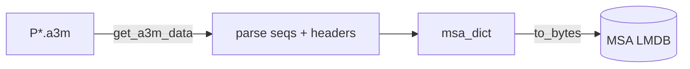

# MSA ingest

Pack per-sequence MSAs (a3m files) into an LMDB keyed by sequence id, then
derive depth-capped copies for training.

- Recipe: `structcooker.workflows.ingest.a3m` (`msa_dict`)
- Configs:
  [`db/msa/a3m.yaml`](https://github.com/SanggeunParrk/StructCooker/blob/main/db/msa/a3m.yaml)
  (protein) and
  [`db/msa/msa_rna.yaml`](https://github.com/SanggeunParrk/StructCooker/blob/main/db/msa/msa_rna.yaml)
  (RNA, `inputs.a3m_type: rna`) — schema `E`, op `build`

| Boundary | Hook | Value |
|----------|------|-------|
| Read | `loader` | `structcooker.instructions.readers.a3m.get_a3m_data` |
| Write | `serializer` | `structcooker.instructions.transforms.codecs.to_bytes` |
| Source | files | `P/*/P*/P*.a3m` (protein) / `R/*/R*/R*.a3m` (RNA) under `MSA_ROOT` (default `DATA_ROOT/BioMol/materials/intermediate/msa`) |
| Dest | LMDB | `OUTPUT_ROOT/lmdb/pdb/msa/a3m.lmdb` / `msa_rna.lmdb` |

The PDB alignments are provided inputs; the release build does not rerun the
HHblits search that produced them (see [MSA reproduction](../msa-reproduction.md)).
The recipe parses sequences and headers and assembles a `msa_dict`
(`sequences` + `headers`). The LMDB key is the file stem (the sequence id).



## Depth caps

Training reads depth-capped copies. Each is a `rebuild` of the base DB through
`structcooker.workflows.exports.cap_msa_depth` (reader adapter
`...transforms.openfold.adapt_msa_for_cap`); only `parameters.max_depth`
differs. The cap keeps the query and the first hits and recomputes the profile
and deletion mean — it is not a random subsample.

| Config | Source | `max_depth` |
| --- | --- | --- |
| `db/msa/a3m_d16k.yaml` | `a3m.lmdb` | 16000 |
| `db/msa/a3m_d2k.yaml` | `a3m.lmdb` | 2000 |
| `db/msa/a3m_d512.yaml` | `a3m.lmdb` | 512 |
| `db/msa/msa_rna_d2k.yaml`, `msa_rna_d512.yaml` | `msa_rna.lmdb` | 2000, 512 |

## Run

```bash
pixi run structcooker build msa/a3m
pixi run structcooker build msa/a3m_d2k      # after msa/a3m completes
# or the whole MSA set, dependencies chained:
pixi run structcooker inspect --strict --manifest db/MANIFEST_msa.yaml
pixi run structcooker build-all --manifest db/MANIFEST_msa.yaml
```

Teddymer and AFDB-multimer MSAs use the same a3m recipe
(`db/teddymer/msa.yaml`, `db/afdb_multimer/msa.yaml`), the teddymer ones fed by
the MMseqs2 [search](search.md).

!!! note "OpenFold distillation MSAs are different"
    The distillation datasets store preprocessed, already-aligned MSAs as
    `alignment.npz` (one or several sources per entry). Those use a dedicated
    reader/recipe — see [OpenFold3 distillation ingest](openfold-distillation.md).
