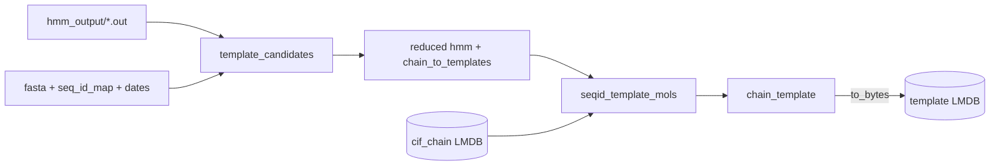

# Template ingest

Resolve template hits (hmmsearch output from [template search](search.md)) into
`TemplateMol` structures read from the per-chain CIF LMDB, and publish a
template DB keyed by `<pdbid>_<chain>`. The PDB template DB is built in four
phases, each its own `db/template/*.yaml`:

| Phase | Config | Op | Recipe | Output |
| --- | --- | --- | --- | --- |
| 0 | `db/template/hmmsearch.yaml` | parallel | `search.hmmsearch` | `materials/intermediate/hmm_output/` (see [Search](search.md)) |
| 1/2 | `db/template/template_candidates.yaml` | materialize | `ingest.template_candidates` | `metadata/seqid_to_chains.tsv`, `chain_to_templates.tsv`, `materials/intermediate/hmm_reduced/` |
| 3 maps | `db/template/template_seqs.yaml` | materialize | `ingest.template_seqs` | `metadata/seqid_to_seq.tsv`, `chain_to_seq.tsv` |
| 3 | `db/template/seqid_template_mols.yaml` | build (keyed), schema `D` | `ingest.seqid_template_mols` | `lmdb/chain/template/seqid_template_mols.lmdb` |
| 4 | `db/template/chain_template.yaml` | build (keyed), schema `D` | `ingest.chain_template_from_seqid` | `lmdb/chain/template/template.lmdb` |

Supporting lists come from `db/metadata/template_chain_filelist.yaml`
(polypeptide(L) chain ids from `cif_pdb.fasta`) and
`db/metadata/seqid_template_filelist.yaml` (the seq ids of `seqid_to_chains.tsv`).
The template coordinates come from the per-chain DB `db/chain/cif_chain.yaml`
(see [Exports](exports.md#per-chain-cif-db)).

- **Phase 1/2** reads every query's hmmsearch hits, groups chains by seq id,
  and keeps up to `topk: 20` templates per chain released on or before
  `date_cutoff: "2021-09-30"` and at least `day_diff: 60` days before the
  query's own release (AF3 rule). Inputs: `cif_pdb.fasta`, `seq_id_map.tsv`,
  `cif_metadata.tsv` (dates). Runs with `inputs.n_jobs: 112` on one node.
- **Phase 3** runs kalign and builds the union of template mols **once per
  seq id** (about 5.7x fewer builds than per chain). The `metadata_recipe`
  `metadata.load_template_seqs` loads the lean seq maps once per worker;
  `inputs.reduced_hmm_dir` and `inputs.cif_chain_db_path` are the hits and
  coordinates.
- **Phase 4** looks each chain's template ids up in the Phase 3 DB and copies
  them out (no kalign, no CIF decode); `metadata.load_phase4_maps` loads
  `seqid_to_chains.tsv` and `chain_to_templates.tsv`.



## Run

```bash
pixi run structcooker build template/template_candidates
pixi run structcooker build template/template_seqs
pixi run structcooker build metadata/seqid_template_filelist
pixi run structcooker build template/seqid_template_mols
pixi run structcooker build template/chain_template
```

Run them in dependency order, or let `build-all` chain them from
`db/MANIFEST_all.yaml` (see the [end-to-end build](../e2e-build.md)).

Teddymer and AFDB-multimer templates follow the same path with
`template_candidates_seqid` and a seq-id-keyed `seqid_template_mols_topk` build
(`db/teddymer/template.yaml`, `db/afdb_multimer/template.yaml`: kalign each
candidate in e-value order, keep those covering 10–95 % of the query, stop at
20).

The older single-pass recipe `ingest.template_lmdb` (with
`metadata.load_template_metadata`) has no `db/` config and is not part of the
release build.

!!! note "OpenFold distillation templates are different"
    The distillation `template.npz` already stores resolved template *hits*
    (`index` / `release_date` / `idx_map`) per entry, so no hmmsearch is run;
    the hits are ranked by coverage and their chains read from `cif_chain`.
    See [OpenFold3 distillation ingest](openfold-distillation.md).
