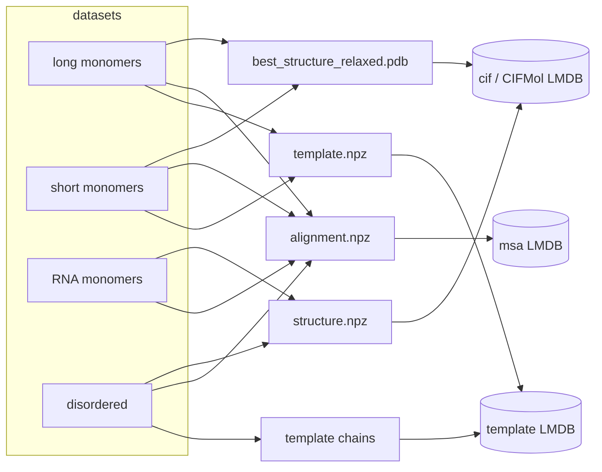

# OpenFold3 distillation ingest

The [OpenFold3 distillation datasets](https://portal.openfold.omsf.io/datasets)
store one folder per entry. The monomer sets ship the released model under
`raw/` and preprocessed arrays under `preprocessed/`:

```text
<set>/raw/<entry_id>/best_structure_relaxed.pdb[.zst]   # released model (pLDDT in B column)
<set>/preprocessed/<entry_id>/alignment.npz              # MSA(s)
<set>/preprocessed/<entry_id>/structure.npz              # flat atom table
<set>/preprocessed/<entry_id>/template.npz               # template hits (protein only)
```

StructCooker ingests four sets — long monomers, short monomers, RNA monomers,
and the PDB-derived disordered set — into structure (`CIFMol`), attached, MSA,
and template LMDBs, with **one reader / transform / writer set per data type**
shared across sets. Raw inputs live under
`BIOMOL_ROOT/materials/raw/openfold_distillation` (fetched by
`structcooker download openfold`); see [raw materials](../raw-materials.md).



!!! note "RNA has no templates"
    RNA monomers ship only `alignment.npz` and `structure.npz`, so no template
    LMDB is built for the RNA set.

## Configs

All live in `db/distillation/` (`<set>` is `long`, `short`, `rna`, `disordered`):

| Output | Config | Schema / op | Recipe |
| --- | --- | --- | --- |
| structure | `<set>_cif.yaml` | `A` / build | long, short: `ingest.teddymer_structure` (PDB model + CCD bonds); rna, disordered: `ingest.openfold_structure` |
| attached | `<set>_cif_attached.yaml` | `B` / rebuild | `metadata.attach` (see [Metadata](metadata.md)) |
| disordered contacts | `disordered_contacts.yaml` | `B` / rebuild | `ingest.disordered_contacts` (recomputes the 6 Å chain–chain contact graph) |
| MSA | `<set>_msa.yaml` | `E` / build | `ingest.openfold_msa` (`max_depth: 65536`) |
| MSA caps | `<set>_msa_d512.yaml`, `_d2k`, `_d5k` (short, rna) | `E` / rebuild | `exports.cap_msa_depth` (`max_depth` 512 / 2000 / 5000) |
| templates | `long_template_topn.yaml`, `short_template_topn.yaml` | `D` / build | `ingest.openfold_template_topn` (`min_coverage: 0.1`, `max_keep: 20`) |
| templates | `disordered_template.yaml` | `D` / build | `ingest.openfold_template_disordered` (4 backbone atoms per protein chain) |

| Piece | Where |
| --- | --- |
| loaders | `instructions/readers/openfold.py` |
| MSA / template transforms | `instructions/transforms/openfold.py` |
| structure → `CIFMol` transform | `instructions/transforms/openfold_structure.py` |
| recipes | `workflows/ingest/openfold_{msa,structure,template_topn,template_disordered}.py`, `teddymer_structure.py` |

### Keys come from the folder or the sequence, not the file

Every entry's file is named the same (`alignment.npz`, ...), so the key is set
by a `key_builder`:

- structures and monomer templates: `openfold_entry_key` — the parent folder
  (the entry id);
- monomer MSAs: `openfold_seqid_key` — the entry's sequence id, looked up in
  `MONOMER_SEQID_MAP` (`BIOMOL_ROOT/materials/intermediate/worklists/distillation_monomer_seqid.tsv`,
  built by `db/metadata/distillation_monomer_seqid.yaml`), so MSAs share the
  seq-id key space of the PDB a3m DB;
- disordered MSAs: `openfold_disordered_seqid_key` via `DISORDERED_SEQID_MAP`;
  disordered templates: `openfold_chain_key` (`<pdbid>_<chain>` stem).

```yaml
# db/distillation/long_msa.yaml
key_builder: structcooker.instructions.readers.openfold.openfold_seqid_key
runtime_environment:
  MONOMER_SEQID_MAP: .../materials/intermediate/worklists/distillation_monomer_seqid.tsv
duplicate_input_policy: first_path
```

Reader maps such as these are declared in `runtime_environment`, so they are
part of the build's fingerprint.

### One reader, every dataset

MSA payloads differ per dataset (protein monomers carry one source; RNA carries
`rnacentral_hits` / `nt_hits` / `rfam_hits`), so the reader returns *all*
sources uniformly and the transform keeps them keyed by source name — the same
code serves every set (`inputs.a3m_type` is `protein` or `rna`).

### Structure records are unified `CIFMol`s

Long and short structures are read from `best_structure_relaxed.pdb[.zst]`
(`get_openfold_pdb_structure_data`) rather than `structure.npz`: the PDB keeps
pLDDT in its B column (→ `b_factor`) and the C-terminal OXT, and bonds come
from the CCD (`inputs.ccd_db_path`). RNA and disordered structures are read
from `structure.npz` (`get_openfold_structure_data`). Either way the transform
rebuilds the residue/chain hierarchy (`IndexTable.from_parents`) into a
`CIFMol` and **derives the chemistry the distillation output lacks**
(`aromatic`, `stereo`, `charge`, `model_xyz`, `formula`, bond types) from the
CCD by residue name, as the mmCIF ingest does; `entity_type` and
`one_letter_code` come from the molecule type and a residue map. The records
therefore share the schema of the PDB `cif_pdb.lmdb`.

### Templates read chains from `cif_chain`

`openfold_template_topn` ranks each entry's `template.npz` hits by query
coverage (from `idx_map` only, no decode), then decodes them best-first from the
per-chain PDB DB (`inputs.cif_chain_db_path`, built by `db/chain/cif_chain.yaml`)
and stops at `max_keep` successes.

## Running a build

```bash
# one output
pixi run structcooker build distillation/long_msa
pixi run structcooker build distillation/rna_cif

# the whole distillation set, as a verified release DAG (resumable)
pixi run structcooker release-build --run-dir <durable run dir>
```

`release-build` defaults to `db/MANIFEST_distillation.yaml` and
`db/distillation-exceptions.json`; it expects the CCD, `cif_chain`, and
`seq_id_map` references to exist already (under `BIOMOL_ROOT`, the references in
`materials/reference/`). See
[release builds](../release-build.md). Sizing, sharding, merging and indexing
are done by the pipeline; outputs above 5M items stay as shard collections
(see the [storage policy](../lmdb-storage-policy.md)). See the
[DataCooker LMDB guide](https://CSSB-SNU.github.io/DataCooker/tutorials/build_lmdb/)
for the engine-side details.
